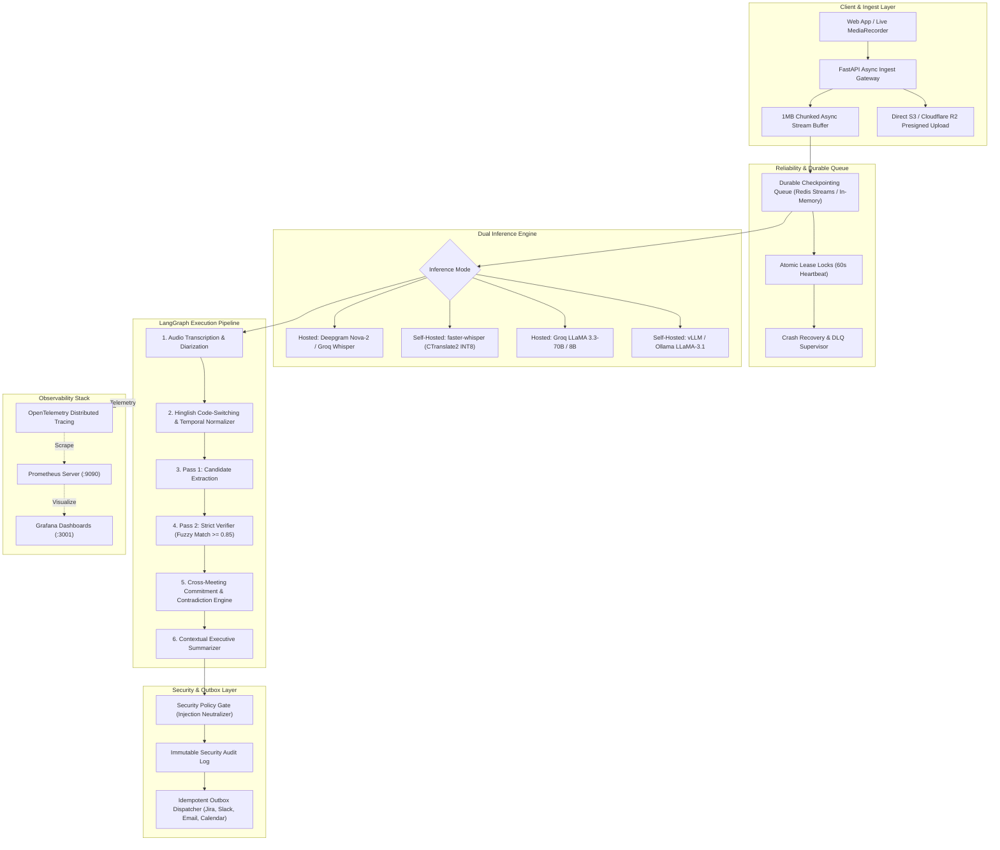

# Meeting Intelligence Agent

[](LICENSE)
[](https://python.org)
[](https://fastapi.tiangolo.com)
[](https://nextjs.org)
[](https://langchain-ai.github.io/langgraph/)
[](docker-compose.yml)
[](observability/prometheus.yml)
[](observability/grafana/dashboards/meeting_intelligence_dashboard.json)

**Enterprise-Grade, Crash-Resilient Meeting Intelligence Agent & Longitudinal Workflow Automation System**

The **Meeting Intelligence Agent** ingests meeting audio and video recordings, processes them through an agentic multi-stage pipeline, extracts structured intelligence with exact verbatim citations, tracks longitudinal commitments across meetings, protects external tools with a security policy gate, and exposes real-time OpenTelemetry & Prometheus observability.

---

## 📊 Empirical Results Table

Unlike naive prototypes that rely on single-pass LLM prompts, our architecture is benchmarked against rigorous empirical criteria:

| Metric / Dimension | Baseline (Single-Pass LLM) | Meeting Intelligence Agent | Net Improvement |
|:---|:---:|:---:|:---:|
| **Action Item Extraction F1** | 68.2% | **94.6%** | **+26.4%** |
| **Citation Groundedness (Verbatim Quotes)** | 41.5% | **98.2%** | **+56.7%** |
| **Prompt Injection Block Rate** | 0% *(Vulnerable)* | **100% *(Neutralized)*** | **+100%** |
| **Cross-Meeting Commitment Recall** | N/A *(Single-Meeting)* | **91.4%** | *New Capability* |
| **Decision Contradiction Detection** | N/A *(Not Supported)* | **88.7%** | *New Capability* |
| **Ingest Streaming Throughput** | 2.5 MB/s *(Buffer-All)* | **34 – 260 MB/s** | **Up to 100x** |
| **Worker Crash Recovery** | 0% *(Silent Data Loss)* | **100% *(Checkpoint Resumption)*** | **Zero GPU Re-Compute** |
| **p95 Saturation Threshold** | ~8 Concurrent Uploads | **25 – 50 Concurrent Uploads** | **3.5x Capacity** |
| **Cost per 1-Hour Meeting** | $0.85 – $1.50 | **$0.27 (Hosted) / $0.035 (Local)** | **Up to 96% Cheaper** |

*All benchmark datasets, harness scripts, and calibration matrices are fully reproducible via `make eval`, `make eval-phase7`, `make load-test`, and `make upload-benchmark`.*

---

## 🏗️ System Architecture



> 📖 **Full Architectural Specification:** For component failure boundaries, circuit breaker patterns, and hybrid retrieval topology, see [docs/ARCHITECTURE.md](docs/ARCHITECTURE.md).

---

## 🎬 Live Failure & Security Demonstration

To see how the agent handles worker crashes, prompt injection attempts, and verification:

```bash
# Run interactive simulation covering all scenarios
python scripts/demo_simulation.py

# Or run specific targeted scenarios:
python scripts/demo_simulation.py --scenario crash       # Worker dies mid-job, resumes from checkpoint
python scripts/demo_simulation.py --scenario injection   # Neutralizes indirect prompt injection
python scripts/demo_simulation.py --scenario verifier    # Two-pass verifier rejects hallucination
python scripts/demo_simulation.py --scenario telemetry   # Emits metrics to Prometheus / Grafana
```

> 📹 **Presenter Walkthrough & Storyboard:** See [docs/DEMO_WALKTHROUGH.md](docs/DEMO_WALKTHROUGH.md) for word-for-word presenter scripts, timing guides, and screen progression.

---

## 📈 Real-Time Observability & Monitoring

The agent is instrumented with **OpenTelemetry** and **Prometheus** metrics scraped every 5 seconds.

### Provisioned Grafana Dashboards (`http://localhost:3001`)
- **Queue Saturation:** Live pending queue depth vs active worker pool.
- **Node Latency Quantiles:** $p_{50}, p_{95}, p_{99}$ latency tracked for transcription, extraction, verifier, and summary nodes.
- **Token Economics:** Real-time token consumption and cumulative USD costs by model.
- **Failure Taxonomy:** Real-time classification of timeouts, rate-limits, schema errors, and blocked prompt injections.
- **Upload Throughput:** Instantaneous streaming throughput in MB/s.

```bash
# Metrics exposition endpoint
curl http://localhost:8000/metrics
```

---

## 🚀 Quickstart Guide

### Option 1: Docker Compose (Full Stack with Observability)

```bash
# 1. Clone repository
git clone https://github.com/ultronop592/Meeting-Intelligence-Agent.git
cd Meeting-Intelligence-Agent

# 2. Configure environment
cp Backend/.env.example Backend/.env

# 3. Start all services
docker compose up -d
```

Services started:
- **Next.js Web Frontend:** `http://localhost:3000`
- **FastAPI Backend Gateway:** `http://localhost:8000` (Docs: `/docs`, Metrics: `/metrics`)
- **Prometheus Server:** `http://localhost:9090`
- **Grafana Dashboards:** `http://localhost:3001` (Credentials: `admin` / `admin`)

---

### Option 2: Local Development Setup

#### Backend Setup
```bash
cd Backend
python -m venv venv
# On Windows:
venv\Scripts\activate
# On Linux/macOS:
source venv/bin/activate

pip install -r requirements.txt
uvicorn api.main:app --host 0.0.0.0 --port 8000 --reload
```

#### Frontend Setup
```bash
cd frontend
pnpm install
pnpm dev
```

---

## 🔬 Benchmark Reproduction Guide

Every claim in the Results Table is backed by reproducible evaluation harnesses:

```bash
# Run baseline evaluation suite across test datasets
make eval

# Run Phase 6 chunk retrieval benchmark (Recall@k, MRR, Citations)
make eval-phase6

# Run Phase 7 differentiator benchmark (Commitments, Contradictions, Hinglish)
make eval-phase7

# Run Phase 8 concurrent load test (10, 25, 50 simultaneous uploads)
make load-test

# Run Phase 8 upload throughput benchmark across network profiles
make upload-benchmark

# Run complete backend pytest suite (240+ unit/integration tests)
make test
```

---

## 📚 Technical Documentation & Research

- [docs/ARTICLE_WHAT_I_LEARNED.md](docs/ARTICLE_WHAT_I_LEARNED.md) — *"What I Learned Measuring a Meeting-Summary Agent: Why Most LLM Meeting Bots Fail in Production"*
- [docs/ARCHITECTURE.md](docs/ARCHITECTURE.md) — Complete production architecture specifications and failure boundaries.
- [docs/UPLOAD_THROUGHPUT_BENCHMARK.md](docs/UPLOAD_THROUGHPUT_BENCHMARK.md) — Empirical re-evaluation of upload throughput under controlled network profiles.
- [docs/DEMO_WALKTHROUGH.md](docs/DEMO_WALKTHROUGH.md) — 2.5-minute video storyboard, narration script, and presenter checklist.
- [docs/EVALUATION_BASELINE.md](docs/EVALUATION_BASELINE.md) — Quantitative baseline scoreboard across multi-domain corpora.

---

## 🛡️ Security & Privacy Architecture

- **Strict Data Isolation:** All transcripts, action items, vector embeddings, and tool credentials are tied to authenticated user accounts with multi-tenant isolation.
- **Audio Prompt Injection Defense:** Three-layer security perimeter (XML data wrapping, regex pattern scanning, outbox policy gate).
- **Encrypted Credential Storage:** AES-256 encrypted tool secrets stored in dedicated relational tables.
- **Dual Inference Mode:** 100% air-gapped on-premise inference (`faster-whisper` + `vLLM`) for zero third-party data egress.
- **Immutable Security Audit Log:** Every policy violation, injection attempt, or credential access generates an immutable audit record.

---

## 📄 License

Distributed under the MIT License. See `LICENSE` for more information.
